# Which brain cells carry the genetic risk for myalgic encephalomyelitis/chronic fatigue syndrome (ME/CFS), and is the pattern specific to the disease?

Palash Rakshit, Redlands, California
Entry for the AAN Neuroscience Research Prize 2027

## Abstract

Myalgic encephalomyelitis/chronic fatigue syndrome (ME/CFS) is a long-lasting illness that affects an estimated 0.8 to 3.3 million people in the United States, most of them women, and it receives a small share of research funding. A large 2025 genetic study, DecodeME (15,579 patients, 259,909 controls), tied the disease to brain tissue. But brain tissue holds hundreds of cell types, and almost every brain trait lights up neurons, so finding neurons says little on its own. I asked a narrower question: which brain cell types carry ME/CFS risk that other brain traits do not? I linked the genetic signal to genes and then to 461 cell clusters from the Human Brain Cell Atlas, and I built a specificity score that compares ME/CFS with 19 other traits. The plan was written and time-stamped before the results. Three control traits first had to reproduce known biology, and they did; the score also recovered the expected cell class in four of five tests. Eleven clusters, mostly excitatory neurons of the cortex and amygdala, were enriched in ME/CFS, and all eleven passed permutation, locus-drop and second-analysis checks. Six were more specific to ME/CFS than the comparison traits, and the strongest was an excitatory cluster from amygdala dissections, Amex_153, which stayed specific across every change I made to the comparison panel. The same clusters also carry signal in a large chronic-pain cohort, though less strongly than in ME/CFS, and the signal was clearest in patients whose illness began with an infection. Independent datasets did not confirm the amygdala label in particular, so I present the result as a hypothesis about excitatory neurons in cortical and limbic circuits that larger cohorts can test.

---

## 1. Introduction

### 1.1 The illness
Myalgic encephalomyelitis/chronic fatigue syndrome (ME/CFS) is a long-term illness whose hallmark is post-exertional malaise: symptoms get worse after physical or mental effort, often a day or more later, and rest does not fix them. The World Health Organization classifies it as a neurological disease (ICD-10 G93.3). It often begins after an infection, and about 80% of patients are women; in the DecodeME study 84% of cases were female (DecodeME Collaboration, 2025).

Estimates of how many people have it in the United States range from 836,000 to 2.5 million (Institute of Medicine, 2015) up to 3.3 million (CDC). More than nine in ten of them have never been diagnosed. Research has not kept pace: published papers per year are a small fraction of those for epilepsy, multiple sclerosis or Parkinson's disease, and NIH funding was about 4 to 9 dollars per patient per year around 2017 to 2019, against about 228 for multiple sclerosis (Figure 1).

### 1.2 What genetics has shown
Until recently, genetic studies of ME/CFS were too small to find reliable signals. DecodeME, a UK study, changed that. It compared 15,579 patients with 259,909 controls and reported eight genome-wide significant locations in the genome, and it found that the genes involved are more active in brain tissue than in immune tissue (DecodeME Collaboration, 2025).

### 1.3 The gap
Knowing the brain is involved is the start of a question, not the end of one. The brain contains hundreds of kinds of cells. A genetic signal spread over many genes tells you something only if you can say which cells those genes are most active in. Single-cell atlases make that possible (Siletti et al., 2023), and the method is well established for other conditions (Skene et al., 2018; Bryois et al., 2020; Watanabe et al., 2019).

There is a second problem. Almost every polygenic brain trait, from schizophrenia to educational attainment, is enriched in neurons. So finding neurons for ME/CFS is weak evidence: it may only reflect the generic behavior of brain genetics. The useful question is whether ME/CFS differs from other traits, and which cell types carry that difference. I could not find any published test that answered it (Section 4.4).

### 1.4 What others have shown
The DecodeME team, a preprint by Maccallini (2026) that combined DecodeME with US veteran data, a 2026 preprint on overlap with irritable bowel syndrome and depression (Lee, 2026), and informal analyses by patient-community members have all reported enrichment in neurons, including striatal and cerebellar types. I treat these as findings to confirm. My contribution is to ask whether the pattern is specific to ME/CFS.

---

## 2. Methods

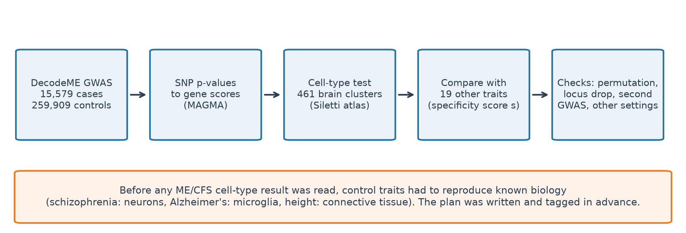

### 2.1 Data
**ME/CFS.** I used the public DecodeME summary statistics (OSF project rgqs3). The main analysis (gwas_1) has 15,579 cases and 259,909 UK Biobank controls. A second analysis (gwas_2) uses the same cases with a different control subset, and there are separate files for infection-triggered onset, non-infectious onset, females and males. I kept only variants on DecodeME's quality-control list (minor allele frequency at least 1%, imputation quality at least 0.9). My first run without this filter produced artefacts near the centromeres of chromosomes 15 and 21, so I discarded it and redid everything (logged in the deviations file).

**Cell types.** The Human Brain Cell Atlas (Siletti et al., 2023) profiles about 3 million nuclei from more than 100 dissections of three adult donors. I used its 461 clusters, grouped into 31 broad cell classes.

**Comparison panel.** I gathered summary statistics for 23 other traits from the GWAS Catalog and kept the 19 that completed the pipeline and had a SNP heritability z-score of at least 4. The panel covers brain traits, immune traits, a body-size trait and three controls (Table 1).

**Table 1. The 19 comparison traits.**

| Trait | Study | Sample size | Accession |
|---|---|---|---|
| Attention deficit hyperactivity disorder (ADuLT model) | Pedersen EM 2023 | 58,286 | GCST90275137 |
| Amyotrophic lateral sclerosis | van Rheenen W 2021 | 152,268 | GCST90027163 |
| Alzheimer's disease | Bellenguez C 2022 | 487,511 | GCST90027158 |
| ICD10 F41.9: Anxiety disorder, unspecified | Brasher MS 2023 | 502,477 | GCST90225527 |
| Autism (adjusted for sex) | Pedersen EM 2023 | 54,976 | GCST90275151 |
| Body mass index | Loh PR 2018 | 532,396 | GCST90029007 |
| Chronotype | Jones SE 2016 | 127,898 | GCST003837 |
| C-reactive protein levels | Said S 2022 | 575,531 | GCST90029070 |
| Depression (broad) | Howard DM 2018 | 322,580 | GCST005902 |
| Educational attainment (years of education) | Loh PR 2018 | 461,457 | GCST90029013 |
| Epilepsy | Sakaue S 2021 | 636,564 | GCST90018840 |
| Height | Yengo L 2022 | 2,200,007 | GCST90245990 |
| Inflammatory bowel disease | de Lange KM 2017 | 59,957 | GCST004131 |
| Irritable bowel syndrome | Eijsbouts C 2021 | 486,601 | GCST90016564 |
| Migraine | Donertas HM 2021 | 484,598 | GCST90038646 |
| Neuroticism | Nagel M 2018 | 449,484 | GCST006476 |
| Parkinson's disease or first degree relation to individual with Parkinson's disease | Nalls MA 2019 | 482,730 | GCST009325 |
| Rheumatoid arthritis | Okada Y 2013 | 79,799 | GCST002318 |
| Schizophrenia | Sakaue S 2021 | 629,347 | GCST90018919 |

**Reference genotypes.** 1000 Genomes Phase 3, 503 European individuals (1000 Genomes Project Consortium, 2015).

### 2.2 Pre-registration
Before looking at any ME/CFS cell-type result, I wrote the full plan, thresholds and the definition of "specific" in text files and tagged them in version control. Every later change was logged with a date and a reason. In total there are eighteen numbered pre-registration documents and a deviations file in the project repository, and each analysis in this report comes from one of them (Figure 2b).

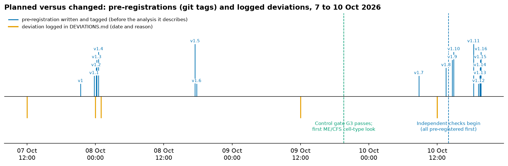

### 2.3 Heritability check
I estimated how much of each trait's variation is inherited with LD score regression (Bulik-Sullivan et al., 2015). The standard software would not install on my computer, so I rewrote the method in Python, tested it on simulated data, and checked it against a published figure (DecodeME's liability-scale heritability of 0.095 for ME/CFS). A trait went on to later steps only if its heritability z-score was at least 4.

### 2.4 From SNPs to genes to cell types
I mapped variants from genome build GRCh38 to standard identifiers (97.6% matched). I combined SNP p-values into one score per gene with MAGMA 1.10 (de Leeuw et al., 2015), assigning SNPs within 35 kb upstream and 10 kb downstream of each gene.

For each of the 461 clusters I made a gene-level specificity score: how much more a gene is expressed in that cluster than in the others (14,049 genes kept). I then asked, with a MAGMA gene-property regression, whether genes that are more specific to a cluster are more strongly associated with the trait. I used three versions:
- **Model A** accounts for each gene's average expression across all clusters.
- **Model B** also accounts for its average expression in neurons.
- **Model C** also accounts for the gene's association with depression, body-mass index and insomnia.

For model A I controlled the false discovery rate across the 461 clusters (Benjamini and Hochberg, 1995) and called a cluster enriched when FDR was below 0.05.

### 2.5 The specificity score
I ran the same pipeline on every comparison trait. For each trait I turned the 461 enrichment values into robust z-scores (median and median absolute deviation). The specificity score *s* for a cluster is the ME/CFS value minus the panel average for that cluster, divided by the panel's spread. A cluster is "specific" when it is enriched (FDR below 0.05 in model A), still nominally significant in model B (p below 0.05), and has *s* of 2 or more.

### 2.6 Controls and validation
Before reading ME/CFS, the pipeline had to pass three checks: schizophrenia enriched in excitatory neurons, Alzheimer's disease enriched in microglia, and the three strongest height clusters being non-neuronal. To test the specificity score itself, I made each of the panel traits the target in turn and scored it against the other 18. The rule, fixed in advance, was that the score should recover the expected cell class in at least four of five known cases (Alzheimer's: microglia; rheumatoid arthritis and inflammatory bowel disease: immune and vascular cells; schizophrenia: excitatory neurons; height: non-neuronal cells).

### 2.7 Confirmation checks
A cluster counts as "confirmed" when it passes the main test and at least two of four further checks:
1. **Second method.** A simplified stratified LD score regression that I wrote and tested (partitioned heritability over cluster annotations).
2. **Permutation null.** I shuffled gene labels within bins of gene size and expression 5,000 times and counted how often a shuffled gene set looked as enriched as the real one.
3. **Locus and chromosome drops.** I removed all genes within 1 Mb of any genome-wide significant SNP and, separately, left out each of the 22 chromosomes in turn.
4. **Second DecodeME analysis (gwas_2).** The same cases with different controls. This checks that the result does not depend on which controls were used. It is not an independent replication.

### 2.8 Robustness checks
After the main result I ran a second set of checks, each written down before it was run:
- The specificity score with each panel trait left out in turn; with 1,000 random half-panels; without the traits most similar to ME/CFS; and without the psychiatric traits.
- A panel of only low-power traits (those with 30 or fewer enriched clusters), and one of only high-power traits.
- Other definitions of specificity: percentile rank within the panel, a panel weighted by how different each trait is from ME/CFS, and a top-decile rule.
- A jackknife over chromosomes for the uncertainty of *s*.
- A false-positive test: 200 simulated traits with no real signal, made by shuffling gene rows within size and expression bins, run through the full rule.
- Removing the genes that contribute most to the two amygdala clusters (top 1, 5 and 20).
- Other ways of assigning SNPs to genes (windows of 0 kb and 50 kb in place of 35/10 kb).
- A projection of what the full DecodeME sample (21,620 cases recruited, 15,579 used here) would give if the effect is real.

### 2.9 Independent and related-data checks
A second computer (macOS) ran a further set of pre-registered checks with its own downloads, so that they would not share my code path or data copy. They asked whether the six clusters hold up outside the main analysis:
- conditioning inside MAGMA on the first five principal components of the 19 comparison traits;
- bulk tissue from the GTEx project (54 tissues; amygdala against other brain regions, a peripheral nerve, and the pituitary);
- an independent single-nucleus atlas of the amygdala, nucleus accumbens and three other regions (Tran et al., 2021), and a fetal whole-body atlas that includes peripheral nerve cells (Cao et al., 2020);
- GWAS of related phenotypes: FinnGen "malaise and fatigue" (31,709 cases), an ME/CFS GWAS from the Million Veteran Program alone (3,891 cases), FinnGen chronic pain (246,393 cases), fibromyalgia and irritable bowel syndrome;
- five genes from a recent UK Biobank and All of Us ME/CFS study, and eight families of drug-target genes;
- matching of the atlas clusters across datasets, and a check that the macOS and Windows pipelines give the same numbers.

Each had a rule fixed in advance (a p-value bar and, where relevant, s of at least 2) and a heritability check before a GWAS was used.

### 2.10 Where in the brain
Each cluster's cells come from known dissected regions. I summed cluster enrichment over the regions their cells came from, weighted by cell counts, to get a map of enrichment by brain region. The 3D figures place regions at approximate positions. They are schematic, not an anatomical image.

### 2.11 Candidate genes (exploratory)
I ranked genes by their association with ME/CFS multiplied by their specificity in the enriched clusters. I tested this ranking on three diseases with known drug targets (migraine, rheumatoid arthritis, inflammatory bowel disease). It only passed for one of the three, so the ME/CFS gene list is exploratory and is not a treatment suggestion.

### 2.12 Software and code
The code is written in Python, with MAGMA 1.10 (a separate program) for the gene analysis. The repository (github.com/palashraks-afk/AAN) contains the code, the dated pre-registrations, every result table and every figure, and a one-command runner that reproduces the pipeline.

---

## 3. Results

### 3.1 The controls worked, and so did the specificity score
First, the heritability step. My re-implementation of LD score regression gave a liability-scale heritability for ME/CFS close to DecodeME's reported 0.095, which supports it. Insomnia failed the heritability cut-off (z of 1.4) and was dropped from the panel, which is why the panel has 19 traits.

The three control checks passed before I looked at ME/CFS. In schizophrenia, 280 of 461 clusters were enriched, mostly excitatory cortical neurons. Alzheimer's disease was enriched in microglia (FDR 3 x 10^-7). The three strongest height clusters were all fibroblasts (Figure 3).

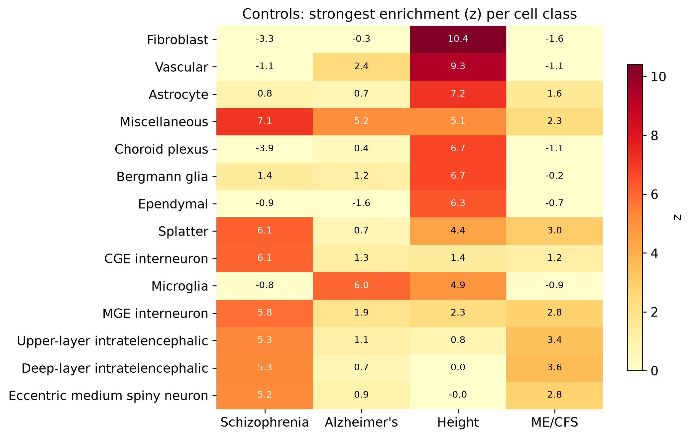

When I scored every panel trait against the others, the specificity score recovered the expected cell class in four of five cases (Figure 4, Table 2). It correctly said that the strongly neuronal traits, such as schizophrenia, educational attainment and neuroticism, have almost no specific clusters (0% to 1.3% of their enriched clusters), because their neuronal signal is shared. For traits with a distinct cell class it found one: microglia and vascular cells for rheumatoid arthritis and inflammatory bowel disease, connective tissue for height. Schizophrenia was the one miss, since its neuronal signal is shared with other brain traits. The result meets the rule I set in advance. For ME/CFS, 6 of 11 enriched clusters (55%) were specific.

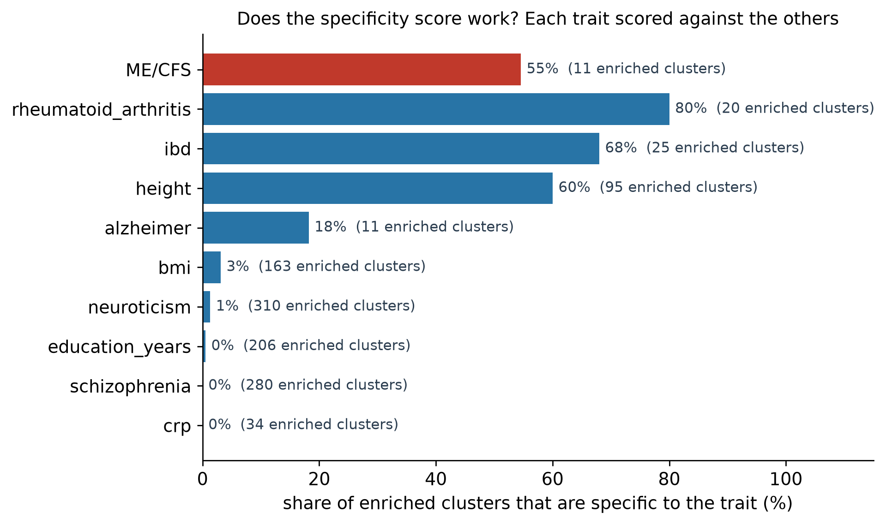

**Table 2. Share of enriched clusters that are specific, for traits with at least three enriched clusters.**

| Trait | Enriched clusters | Specific | Share specific | Specific cell classes |
|---|---|---|---|---|
| neuroticism | 310 | 4 | 1.3% | Deep-layer intratelencephalic;Miscellaneous;Splatter |
| schizophrenia | 280 | 0 | 0.0% | none |
| education_years | 206 | 1 | 0.5% | Hippocampal dentate gyrus |
| bmi | 163 | 5 | 3.1% | CGE interneuron;Deep-layer intratelencephalic |
| height | 95 | 57 | 60.0% | Astrocyte;Bergmann glia;Choroid plexus;Committed oligodendro |
| crp | 34 | 0 | 0.0% | none |
| ibd | 25 | 17 | 68.0% | Fibroblast;Microglia;Miscellaneous;Vascular |
| rheumatoid_arthritis | 20 | 16 | 80.0% | Microglia;Miscellaneous;Vascular |
| alzheimer | 11 | 2 | 18.2% | Microglia |

### 3.2 Eleven cell clusters are enriched in ME/CFS
In the main analysis, 11 of the 461 clusters were enriched at FDR below 0.05 (Table 3). They are excitatory neurons: six deep-layer and two upper-layer intratelencephalic neurons (cortical neurons that project within the cortex and to the striatum), two clusters labelled amygdala excitatory, and one cluster in a mixed group. The strongest z-score was 3.58. Medium spiny neurons, which earlier reports highlighted, were not significant in this analysis (best z 2.8).

All eleven clusters passed the confirmation checks. In the permutation test with 5,000 shuffles, ten had an empirical p-value of 0.0004 or lower and the eleventh 0.001 (the smallest possible value is 0.0002). All eleven were also significant in the stratified heritability analysis, the second DecodeME analysis, and after removing genome-wide significant loci and leaving out each chromosome in turn.

**Table 3. The 11 enriched clusters and their checks.** Model B p is nominal. FDR in model C is across all 461 clusters. "Specific" means FDR below 0.05 in model A, p below 0.05 in model B and s of at least 2.

| Cluster | Cell class | z | FDR (model A) | p (model B) | FDR (model C) | s | Specific | S-LDSC p | Permutation p | 2nd analysis p |
|---|---|---|---|---|---|---|---|---|---|---|
| DLIT_136 | Deep-layer intratelencephalic | 3.58 | 0.033 | 3.7e-04 | 0.050 | 0.87 | no | 1.8e-05 | 2.0e-04 | 7.0e-04 |
| DLIT_151 | Deep-layer intratelencephalic | 3.48 | 0.033 | 5.3e-04 | 0.050 | 1.88 | no | 5.1e-04 | 2.0e-04 | 2.3e-04 |
| Amex_153 | Amygdala excitatory | 3.43 | 0.033 | 6.4e-04 | 0.050 | 2.98 | yes | 1.1e-05 | 2.0e-04 | 7.3e-05 |
| DLIT_152 | Deep-layer intratelencephalic | 3.37 | 0.033 | 7.7e-04 | 0.050 | 2.03 | yes | 0.002 | 2.0e-04 | 1.1e-04 |
| ULIT_126 | Upper-layer intratelencephalic | 3.37 | 0.033 | 7.6e-04 | 0.050 | 1.64 | no | 6.0e-05 | 2.0e-04 | 1.6e-04 |
| ULIT_121 | Upper-layer intratelencephalic | 3.34 | 0.033 | 8.7e-04 | 0.050 | 2.35 | yes | 2.4e-04 | 4.0e-04 | 1.0e-04 |
| DLIT_148 | Deep-layer intratelencephalic | 3.29 | 0.034 | 0.001 | 0.055 | 1.29 | no | 1.3e-04 | 4.0e-04 | 3.3e-04 |
| DLIT_150 | Deep-layer intratelencephalic | 3.23 | 0.036 | 0.001 | 0.050 | 2.01 | yes | 9.0e-05 | 2.0e-04 | 2.5e-04 |
| Amex_175 | Amygdala excitatory | 3.16 | 0.040 | 0.002 | 0.068 | 2.50 | yes | 0.002 | 2.0e-04 | 3.7e-04 |
| DLIT_147 | Deep-layer intratelencephalic | 3.08 | 0.048 | 0.002 | 0.071 | 1.10 | no | 7.8e-04 | 2.0e-04 | 0.002 |
| Splat_402 | Splatter | 3.04 | 0.049 | 0.003 | 0.076 | 2.41 | yes | 0.017 | 0.001 | 0.002 |

### 3.3 Six of the eleven are more specific to ME/CFS than other traits
Six clusters have a specificity score of 2 or more: Amex_153 (s = 2.98), Amex_175 (2.50), Splat_402 (2.41), ULIT_121 (2.35), DLIT_152 (2.03) and DLIT_150 (2.01). The other five are enriched in ME/CFS but are enriched in other brain traits to a similar degree (Figure 5). The clusters that stand furthest above the panel are the two labelled amygdala excitatory.

The ME/CFS cell-type profile as a whole looks most like those of educational attainment, schizophrenia, body-mass index and neuroticism, and least like those of height, migraine and rheumatoid arthritis (Figure 6). This fits ME/CFS having a neuronal component, and shows why the comparison panel matters.

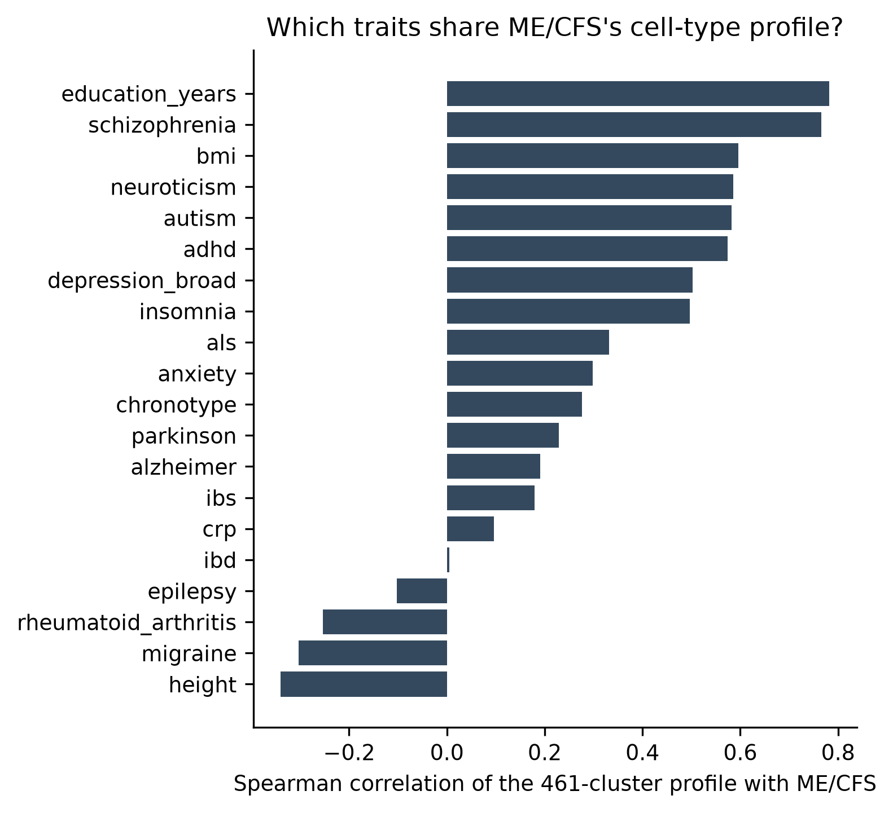

### 3.4 Accounting for neuronal expression and other traits
When I also accounted for average neuronal expression (model B), the eleven clusters stayed nominally significant (p between 0.0004 and 0.003; Figure 7), but none stayed under FDR 0.05 across all 461 clusters. With depression, body-mass index and insomnia genetics taken into account (model C), seven clusters were still at FDR 0.05 or below, including four of the six specific clusters. This tells me the signal is not just average neuronal expression, but also that the data have limited power for the strictest versions of the test.

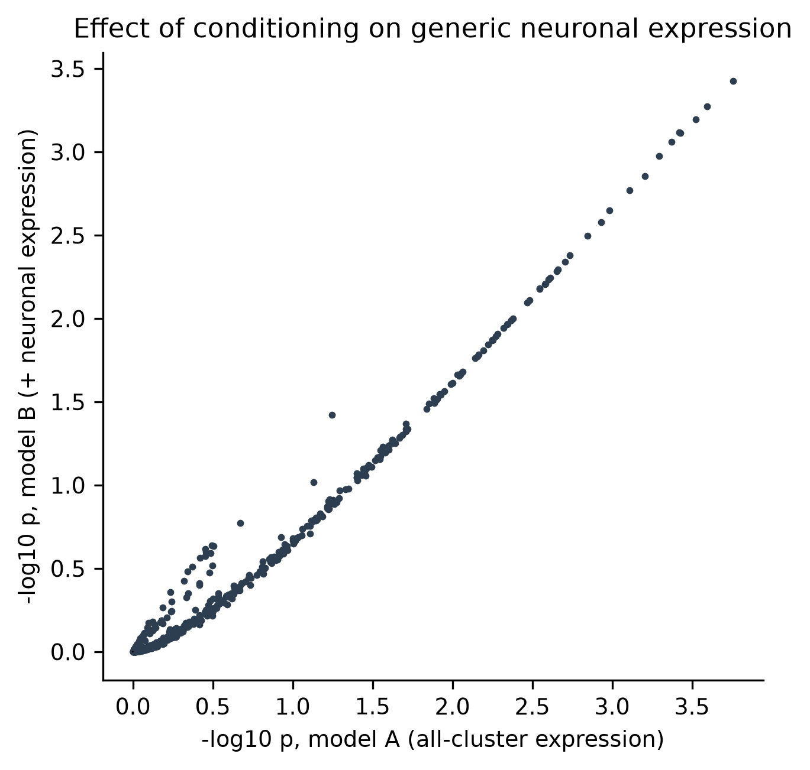

### 3.5 The specificity holds when the comparison changes
A specificity score depends on the comparison traits, so I tested it many ways (Figure 8, Table 4).
- **Dropping one trait at a time.** The lowest score for Amex_153 across all 19 panels was 2.89, and for Amex_175 2.42.
- **Random half panels.** Amex_153 was specific in 100% of 1,000 random half panels, and Amex_175 in 88%.
- **Removing similar traits.** Without schizophrenia, educational attainment, BMI and neuroticism, Amex_153 rose to 4.02; without the psychiatric traits it was 3.06.
- **Low-power panel.** With only the 13 traits of power comparable to ME/CFS, all six clusters kept s of 2 or more (Amex_153: 4.01).
- **Other definitions.** All six clusters ranked above every one of the 19 panel traits, and had a weighted score of 2.17 or more (up to 3.57 for Amex_153).
- **A pain trait added to the panel.** When FinnGen chronic pain and fibromyalgia were added (21 traits), five of the six clusters stayed specific (Amex_153 2.97, Splat_402 2.43, ULIT_121 2.38, Amex_175 2.13, DLIT_150 2.02); DLIT_152 fell to 1.81.
- **False positives.** In 200 simulated traits with no real signal, one produced a specific cluster (0.5%; my limit was 5%).

Only the two amygdala clusters met my pre-set definition of robust to panel choice (specific in at least 90% of leave-one-out panels and at least 80% of half-panels). The four cortical clusters sit at the cutoff.

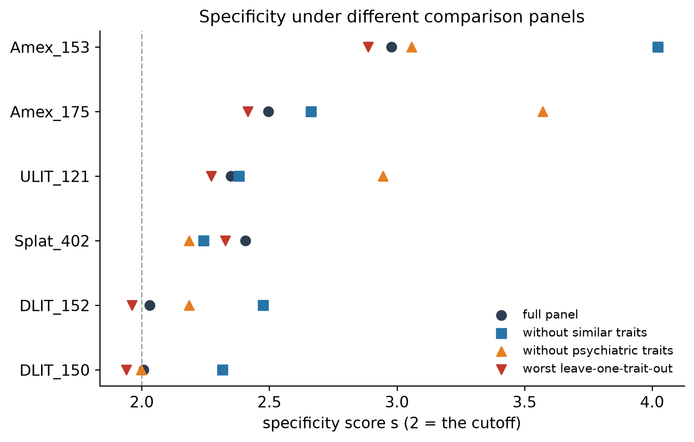

**Table 4. Specificity of the six clusters under changes to the comparison panel.**

| Cluster | s (all 19) | Lowest s, drop one trait | Share of half panels with s >= 2 | s without similar traits | s without psychiatric traits |
|---|---|---|---|---|---|
| Amex_153 | 2.98 | 2.89 | 100% | 4.02 | 3.06 |
| Amex_175 | 2.5 | 2.42 | 88% | 2.66 | 3.57 |
| ULIT_121 | 2.35 | 2.27 | 77% | 2.38 | 2.95 |
| Splat_402 | 2.41 | 2.33 | 80% | 2.24 | 2.18 |
| DLIT_152 | 2.03 | 1.96 | 54% | 2.48 | 2.18 |
| DLIT_150 | 2.01 | 1.94 | 56% | 2.32 | 2.0 |

The signal is also spread across many genes. Removing the 20 genes that contribute most to each amygdala cluster lowered the enrichment z from 3.43 to 2.81 (Amex_153) and from 3.16 to 2.36 (Amex_175), and both stayed nominally significant (Figure 9, right).

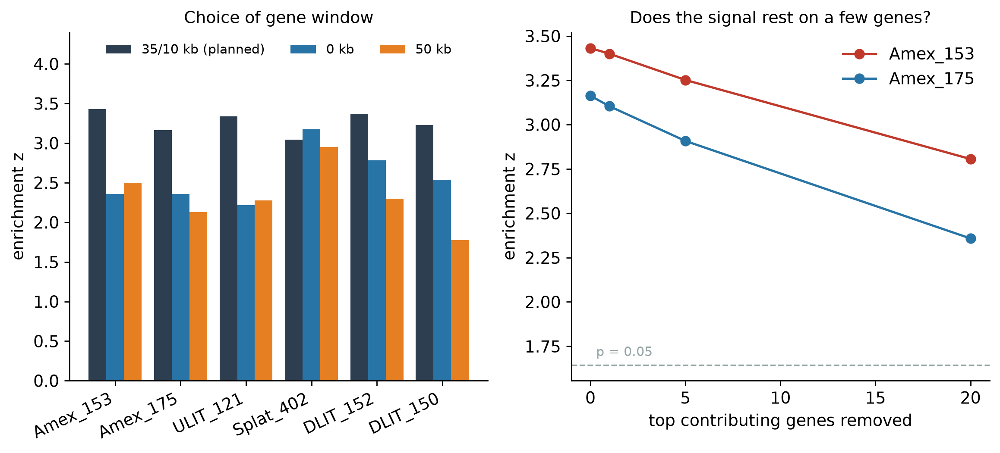

### 3.6 Where the cells come from, in 3D
Each cluster's cells come from dissections of known brain regions. For Amex_153, 93% of cells come from amygdala dissections, so it is an amygdala population. For Amex_175, 91% come from cerebral cortex dissections (only 1% from the amygdala), so I call it a related cortical population that carries an "amygdala excitatory" label in the atlas. Placing enrichment onto brain regions, the amygdala ranks second of 17 regions for ME/CFS, after paleocortex, followed by cerebral cortex, claustrum and extended amygdala (Figure 10). The pattern is concentrated in deep and limbic structures, which is consistent with imaging studies that report changes in the amygdala, thalamus and brainstem in ME/CFS (Nakatomi et al., 2014).

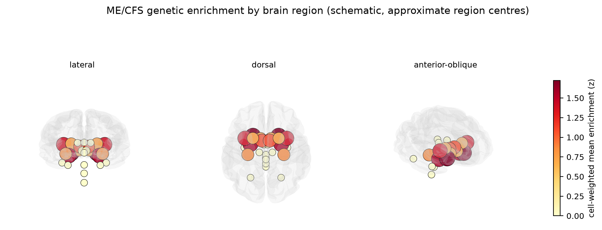

I also placed all 461 clusters in a 3D map of cell-type similarity (the first three principal components of their expression profiles) and coloured them by ME/CFS enrichment (Figure 11). The enriched clusters sit together at one end of the map, in the excitatory-neuron region, and not at the glial or vascular end. An interactive version is in the repository.

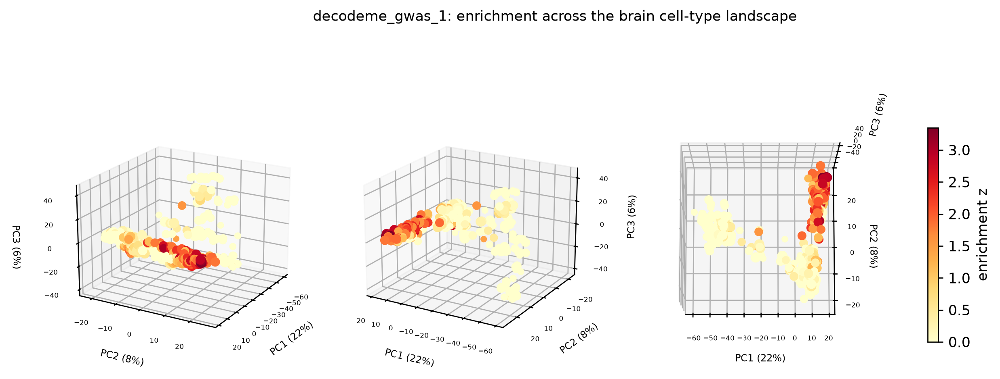

### 3.7 The signal is clearest in infection-triggered ME/CFS
In patients whose illness began with an infection, all six clusters passed a strict Bonferroni threshold for 24 tests (p below 0.002; Amex_153 p = 6.8 x 10^-5). They did not in patients with non-infectious onset, in females only or in males only (Figure 12). These subsets overlap and differ in size, so I read this as descriptive: the signal is not spread evenly, and the infection-triggered group carries most of it. In that group, 55 clusters were enriched at FDR below 0.05.

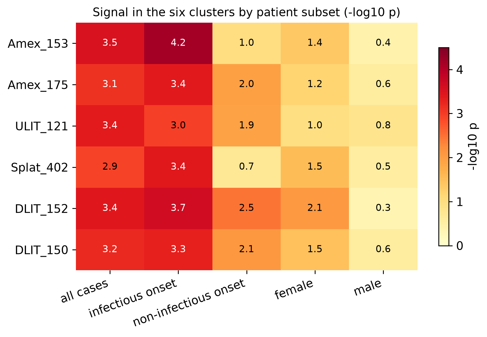

### 3.8 Other layers
- **Whole-body cell types.** Of 154 cell types across the body, 12 were enriched, including the three brain neuron groups with the strongest signal (inhibitory, excitatory and other neurons), so the data support a neural signal but also some non-neural types.
- **Pathways.** No pathway among 1,713 was significant after correction.
- **Imaging.** A set of brain regions drawn from the imaging literature did not stand out beyond the comparison traits.
- **Candidate genes (exploratory).** The top-ranked genes were ISL1, CACNA1E, STT3B, DCC and PCDH17 (Table 5). Because the ranking only passed its benchmark for one of three diseases, these are labelled exploratory. I drew backbone models of their protein structures from AlphaFold predictions (Figure 13).

**Table 5. Top ten genes by the exploratory ranking.**

| Gene | Gene z | Gene p | Rank percentile |
|---|---|---|---|
| ISL1 | 3.39 | 3.5e-04 | 1.0 |
| CACNA1E | 4.65 | 1.6e-06 | 1.0 |
| STT3B | 3.77 | 8.3e-05 | 1.0 |
| DCC | 4.53 | 2.9e-06 | 1.0 |
| PCDH17 | 4.57 | 2.4e-06 | 1.0 |
| LRRC7 | 6.07 | 6.4e-10 | 1.0 |
| VANGL2 | -4.15 | 1.000 | 1.0 |
| VWC2 | 4.21 | 1.3e-05 | 0.999 |
| SORCS3 | 3.81 | 7.1e-05 | 0.999 |
| ARFGEF2 | 5.82 | 3.0e-09 | 0.999 |

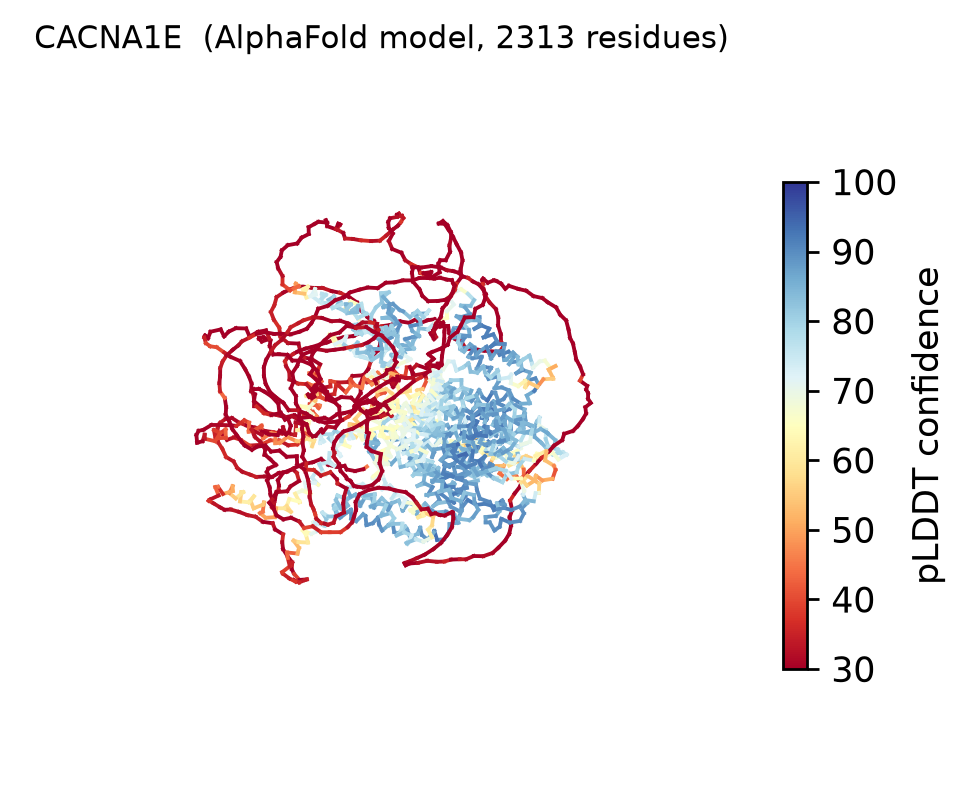
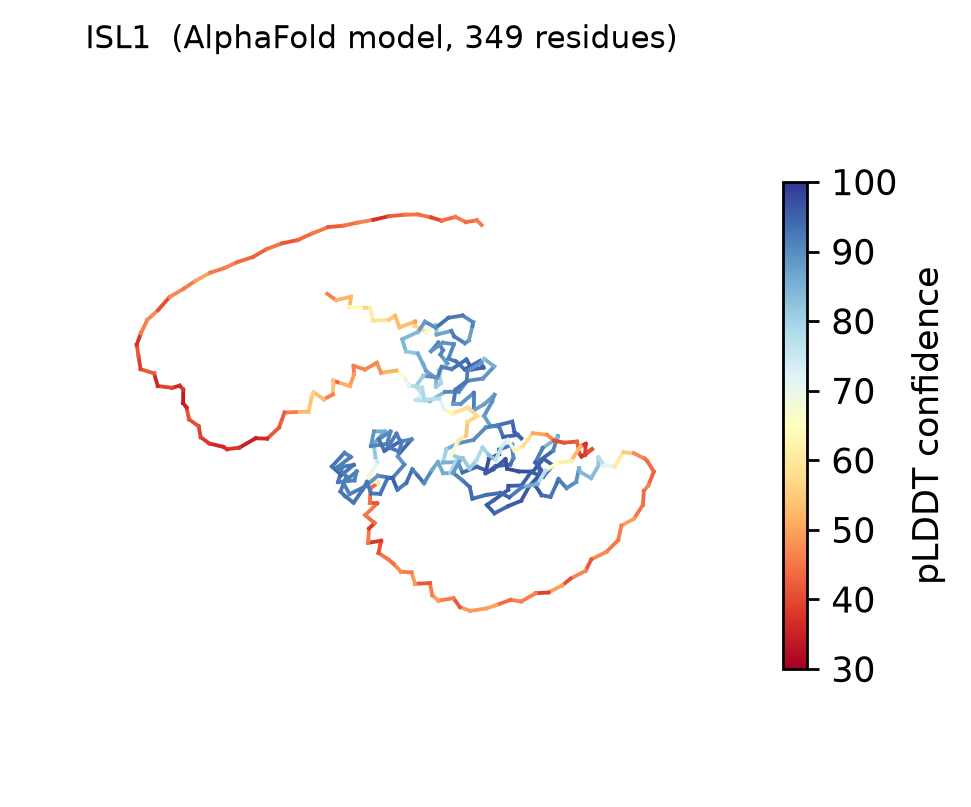
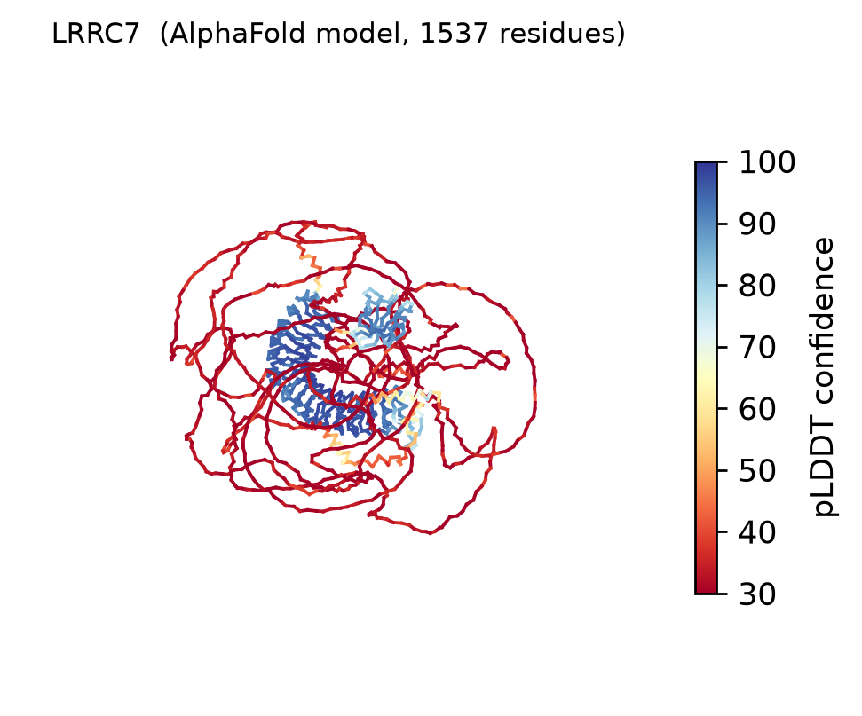

*Figure 13. AlphaFold-predicted structures of three top-ranked genes (CACNA1E, ISL1, LRRC7), drawn as backbone traces coloured by the model's own confidence. They show protein shape and say nothing about disease. Interactive versions are in figures/structures.*

### 3.9 Independent and related-data checks
A second computer ran a set of independent and related-data checks (Table 6). None met its pre-registered bar for confirming the amygdala result, and none contradicted it; each had limited power or measured a different phenotype or tissue. Two points matter most. First, in an independent single-nucleus atlas, the ME/CFS signal in excitatory neurons pointed to cortical groups (subgenual anterior cingulate, p about 0.006) more than amygdala ones (p 0.12 to 0.18), although that atlas has only 344 and 55 amygdala excitatory nuclei and its labels do not map one-to-one onto the main atlas. The amygdala clusters do match amygdala excitatory neurons in it (rank correlation of about 0.66), so the comparison is fair, just underpowered. Second, the six clusters also carry strong signal in a large chronic-pain cohort (mean z 2.46 against 1.39 for random sets of six clusters, p = 0.0001, all six positive). This does not undo the specificity result, because pain was not in the 19-trait panel; with pain added, five of six clusters stay specific and every cluster is stronger in ME/CFS than in pain. It does mean these clusters are better described as carrying signal for ME/CFS and chronic pain together, which fits a shared-circuit hypothesis.

**Table 6. Independent and related-data checks.**

| Check | Question | Result |
|---|---|---|
| Conditioning on 5 principal components of the 19 traits | Does specificity survive removing shared genetics? | No cluster at FDR below 0.05 (best 0.073); Amex_153 keeps the highest s (3.69) |
| GTEx bulk tissue | Is the amygdala special among brain regions? | No (p = 0.49); pituitary enriched but not specific (s 1.1); peripheral nerve null |
| Independent single-nucleus atlas (Tran 2021, five regions) | Amygdala excitatory neurons? | Not significant (p 0.12 to 0.18); strongest excitatory groups were cortical; only 344 and 55 amygdala nuclei |
| Fetal whole-body atlas (Cao 2020) | Peripheral nerve cells or fetal limbic neurons? | No (best peripheral p = 0.054; limbic s = 0.97); fetal neurons in general carry the signal |
| FinnGen malaise and fatigue (31,709 cases) | Do the six clusters carry over? | Mean z 0.32 against a 95th percentile of 0.44 (p = 0.099); a broad symptom code, not ME/CFS |
| Million Veteran Program ME/CFS alone (3,891 cases) | Do the six clusters carry over? | Heritability z 2.9, below the gate of 4, so descriptive only (4 of 6 positive) |
| Replicated-locus genes (5 genes) | Are they specific to the amygdala clusters? | No (p 0.28 and 0.38); five genes is too few to say |
| Drug-target gene families (8) | Do any carry signal beyond brain expression? | Ion channels and nuclear receptors nominal (p 0.02 to 0.03), FDR 0.12 |
| FinnGen chronic pain (246,393 cases) | Do the six clusters carry signal here too? | Yes (mean z 2.46 against 1.39; p = 0.0001; all six positive) |
| Fibromyalgia (4,005 cases) and IBS | Same? | Fibromyalgia p = 0.040 (not significant after correction); IBS null |
| Pain added to the panel | Are the six still specific? | Five of six (DLIT_152 falls to 1.81); stronger in ME/CFS than in pain for every cluster |
| Cross-atlas identity | Do the amygdala clusters match amygdala excitatory neurons elsewhere? | Yes (rho 0.66 to 0.67) |
| macOS against Windows pipeline | Same numbers on another computer? | Yes (Spearman 1.000 across 461 clusters) |

A full list of every pre-registered test and its outcome is in the repository (docs/15_test_ledger.md). Because many checks were run around one result, I read the main false-discovery rate of 0.03 to 0.05 as modest.

### 3.10 If the effect is real, the full dataset should show it
DecodeME recruited 21,620 cases; this analysis used 15,579. If the effect is real, scaling the z-scores to the larger sample would put 24 clusters under FDR 0.05 even in model B, including all six specific clusters (best FDR 0.009 to 0.021). This is a projection, not a result, but it shows what the next data release can settle.

---

## 4. Discussion

### 4.1 What I found
Most of the neuronal signal in ME/CFS looks like the generic neuronal signal of other brain traits. A small part does not. A set of excitatory clusters, mainly deep- and upper-layer cortical neurons and two labelled amygdala, carry ME/CFS signal that exceeds what 19 other traits show. The strongest, Amex_153, really is an amygdala population (93% of its cells come from amygdala dissections), and its specificity is robust to the choice of comparison traits, the definition of specificity, the removal of the most influential genes, and the removal of any one chromosome. The signal is clearest in patients whose illness began with an infection. The independent checks I could run did not confirm the amygdala label in particular, and the same clusters carry signal in chronic pain.

### 4.2 What this might mean
The amygdala and the limbic cortex are central to threat detection, stress responses, pain affect and autonomic regulation, and imaging studies of ME/CFS have reported changes in the amygdala (Nakatomi et al., 2014). Excitatory neurons in these circuits fit an existing picture, and give researchers a more specific place to look than "the brain". The overlap with chronic pain is consistent with a hypothesis that ME/CFS and chronic pain share circuitry. This is a hypothesis: the genetics point to where to look, and say nothing about whether those cells cause symptoms, what they do in patients, or what could be done about it.

### 4.3 The method is the broader contribution
The specificity score is general. It asks of any disease, once it has been tested against enough other traits: is this cell type special to my disease, or does every brain trait show it? Many disease papers report the cell types they find without that test. In my panel, the strongly neuronal traits had almost no specific clusters, which suggests that raw enrichment lists for such traits would mostly be generic. Showing that the score recovers known biology (Alzheimer's: microglia; rheumatoid arthritis and IBD: immune cells; height: connective tissue) gives it credibility, and the simulations show it rarely fires by chance.

### 4.4 How this relates to earlier work
Neuronal enrichment in ME/CFS has been reported by the DecodeME team, by Maccallini (2026), and by informal community analyses that also noted amygdala and cortical excitatory cell types. In this respect my result confirms them. To my knowledge, a test of whether ME/CFS cell types are specific compared with a panel of other traits, with robustness checks and a pre-registered plan, has not been reported. I did not find one in PubMed, Europe PMC (which indexes medRxiv, bioRxiv and Research Square), web searches, the citations of the DecodeME preprint, or the DecodeME project page. The closest paper, Lee (2026), found enrichment in inhibitory and enteric neurons with a different atlas and no cross-trait calibration. Cross-trait comparison itself is not new in general: Duncan et al. (2025) mapped schizophrenia and other brain phenotypes onto the same atlas and noted which cell types recur across traits, and ECLIPSER (Rouhana et al., 2021) tests cell-type enrichment against a background of loci from unrelated traits. Neither addresses ME/CFS, and neither scores the ME/CFS profile against a panel of traits cluster by cluster as I do here. General-purpose tools such as seismic (Lai et al., 2025) improve how a gene's specificity to a cell type is scored and how influential genes are found; from their descriptions they do not ask whether a disease's association with a cell type exceeds what a panel of other traits shows, which is what the score here does. My searches were run on 10, 11 and 18 October 2026 (a second computer repeated them on 17 October) and found nothing new. A search cannot prove that something does not exist, so I state this as what I found and not as a certainty.

### 4.5 Limitations of this study
These are limits of my own analysis, not of earlier work.

- **Statistical evidence is moderate.** The enriched clusters have z-scores around 3 to 3.6 and FDR of 0.03 to 0.05 in the planned analysis. Under the strictest conditioning (model B) none stays under FDR 0.05, and the uncertainty of the specificity score is wide (the jackknife interval for *s* of Amex_153 runs from about 0.6 to 5.2).
- **Choices in the pipeline matter.** With a different SNP-to-gene window (0 kb or 50 kb instead of the standard 35/10 kb that I fixed beforehand), the same clusters keep their rank but fall under the FDR cutoff.
- **Independent replication is open.** The second DecodeME analysis shares all cases, so it is a check on the controls and not a replication. The independent or related-data checks I could run (a second brain atlas, bulk GTEx tissue, a fatigue cohort, a veteran cohort below the heritability gate, five replicated-locus genes) fell short of their pre-registered bars; each was weak or indirect, for the reasons in Table 6, so none refutes the result and none supports it.
- **Not specific to ME/CFS alone.** The same clusters carry signal for chronic pain. The result is specific relative to the 19-trait panel, not relative to every possible trait.
- **Many checks were run.** Because I ran many checks around one result, the main false-discovery rate of 0.03 to 0.05 should be read as modest.
- **Atlas and population.** The atlas comes from three adult donors and covers the central nervous system only, so peripheral nerves, immune cells and the autonomic system are thin. DecodeME is European ancestry and 84% female, and case status comes from a questionnaire.
- **Association is not causation.** The result says where signal is enriched, and not what the cells do.
- **Candidate genes are exploratory.** The ranking passed its benchmark for one of three diseases.

### 4.6 Next steps
1. **Test it in the full DecodeME release** (21,620 cases), where the projection says the six clusters should pass the strictest model. If they do not, that is itself informative.
2. **Replicate in an independent cohort** with a different ascertainment, for example when other large ME/CFS genetic studies report.
3. **Look at the cells directly.** Single-nucleus data from the amygdala of patients and controls would show whether the genes behind this signal change in patients. That is a question for researchers with tissue access.
4. **Use the method on other diseases.** The panel and code are open, so others can test their own diseases.

---

## 5. Conclusion
I asked which brain cell types carry ME/CFS genetic risk beyond what other traits show. A small set of excitatory neurons, led by an amygdala cluster (Amex_153), stands out against 19 comparison traits, and the same clusters carry signal in chronic pain. This fills a gap: earlier work reported neurons in general, and this is a calibrated, pre-registered test of which cell types are specific, with a score that was validated on known biology and that others can reuse for other diseases. It gives researchers a more specific population of cells to test than "the brain", and the full DecodeME data and cell-level studies of patient tissue can now check it.

## 6. Data and code availability
All data used are public: DecodeME summary statistics (OSF rgqs3), the Human Brain Cell Atlas, the GWAS Catalog, and the 1000 Genomes reference. Code, dated pre-registrations (tags prereg-v1 to prereg-v1.18), every result table, figures, and a one-command runner are at https://github.com/palashraks-afk/AAN. No human or animal subjects were recruited for this work.

## 7. Acknowledgements
I thank the DecodeME participants and team for releasing their data, the authors of the comparison studies, and the creators of the Human Brain Cell Atlas, MAGMA, and the AlphaFold database. I thank Ms. Heather Wingo, my AP Biology teacher at Redlands High School, for supporting my application.

**Use of AI.** I wrote some of the early analysis code and an initial rough draft of parts of the writing myself. I then used AI assistants (Claude, from Anthropic, and Gemini, from Google, earlier in the project) to edit that code and text, and to help with the literature search, write and run the rest of the analysis code, and draft and edit sections of this report and the abstract. I chose the research question, made the design decisions, reviewed the results and checked the claims, and I take responsibility for the content.

## References
1. 1000 Genomes Project Consortium. A global reference for human genetic variation. Nature 526, 68-74 (2015). doi:10.1038/nature15393
2. Bellenguez C, et al. New insights into the genetic etiology of Alzheimer's disease and related dementias. Nat Genet 54, 412-436 (2022). doi:10.1038/s41588-022-01024-z
3. Benjamini Y, Hochberg Y. Controlling the false discovery rate: a practical and powerful approach to multiple testing. J R Stat Soc B 57, 289-300 (1995).
4. Bryois J, et al. Genetic identification of cell types underlying brain complex traits yields insights into the etiology of Parkinson's disease. Nat Genet 52, 482-493 (2020). doi:10.1038/s41588-020-0610-9
5. Bulik-Sullivan BK, et al. LD Score regression distinguishes confounding from polygenicity in genome-wide association studies. Nat Genet 47, 291-295 (2015). doi:10.1038/ng.3211
6. de Leeuw CA, Mooij JM, Heskes T, Posthuma D. MAGMA: generalized gene-set analysis of GWAS data. PLoS Comput Biol 11, e1004219 (2015). doi:10.1371/journal.pcbi.1004219
7. DecodeME Collaboration. Initial findings from the DecodeME genome-wide association study of myalgic encephalomyelitis/chronic fatigue syndrome. medRxiv (2025). doi:10.1101/2025.08.06.25333109
8. Finucane HK, et al. Heritability enrichment of specifically expressed genes identifies disease-relevant tissues and cell types. Nat Genet 50, 621-629 (2018). doi:10.1038/s41588-018-0081-4
9. Howard DM, et al. Genome-wide meta-analysis of depression identifies 102 independent variants and highlights the importance of the prefrontal brain regions. Nat Neurosci 22, 343-352 (2019). doi:10.1038/s41593-018-0326-7
10. Institute of Medicine. Beyond Myalgic Encephalomyelitis/Chronic Fatigue Syndrome: Redefining an Illness. National Academies Press (2015). doi:10.17226/19012
11. Lee JH. Global and local genetic overlap among ME/CFS, irritable bowel syndrome and psychiatric traits: a hypothesis-generating analysis. medRxiv (2026). doi:10.64898/2026.06.08.26355171
12. Maccallini P. Biological insights from genome-wide association studies and whole genome sequencing of myalgic encephalomyelitis/chronic fatigue syndrome. Research Square preprint (2026). doi:10.21203/rs.3.rs-9702020/v1
13. Nosek BA, et al. The preregistration revolution. Proc Natl Acad Sci USA 115, 2600-2606 (2018). doi:10.1073/pnas.1708274114
14. Sakaue S, et al. A cross-population atlas of genetic associations for 220 human phenotypes. Nat Genet 53, 1415-1424 (2021). doi:10.1038/s41588-021-00931-x
15. Siletti K, et al. Transcriptomic diversity of cell types across the adult human brain. Science 382, eadd7046 (2023). doi:10.1126/science.add7046
16. Skene NG, et al. Genetic identification of brain cell types underlying schizophrenia. Nat Genet 50, 825-833 (2018). doi:10.1038/s41588-018-0129-5
17. Watanabe K, Umicevic Mirkov M, de Leeuw CA, van den Heuvel MP, Posthuma D. Genetic mapping of cell type specificity for complex traits. Nat Commun 10, 3222 (2019). doi:10.1038/s41467-019-11181-1
18. Yengo L, et al. A saturated map of common genetic variants associated with human height. Nature 610, 704-712 (2022). doi:10.1038/s41586-022-05275-y
19. Nakatomi Y, et al. Neuroinflammation in patients with chronic fatigue syndrome/myalgic encephalomyelitis: an 11C-(R)-PK11195 PET study. J Nucl Med 55, 945-950 (2014). doi:10.2967/jnumed.113.131045
20. Jumper J, et al. Highly accurate protein structure prediction with AlphaFold. Nature 596, 583-589 (2021). doi:10.1038/s41586-021-03819-2
21. Varadi M, et al. AlphaFold Protein Structure Database in 2024. Nucleic Acids Res 52, D368-D375 (2024). doi:10.1093/nar/gkad1011
22. Lai Q, Dannenfelser R, Roussarie JP, Yao V. Disentangling associations between complex traits and cell types with seismic. Nat Commun 16, 8744 (2025). doi:10.1038/s41467-025-63753-z
23. Tran MN, et al. Single-nucleus transcriptome analysis reveals cell-type-specific molecular signatures across reward circuitry in the human brain. Neuron 109, 3088-3103 (2021). doi:10.1016/j.neuron.2021.09.001
24. Cao J, et al. A human cell atlas of fetal gene expression. Science 370, eaba7721 (2020). doi:10.1126/science.aba7721
25. GTEx Consortium. The GTEx Consortium atlas of genetic regulatory effects across human tissues. Science 369, 1318-1330 (2020). doi:10.1126/science.aaz1776
26. Kurki MI, et al. FinnGen provides genetic insights from a well-phenotyped isolated population. Nature 613, 508-518 (2023). doi:10.1038/s41586-022-05473-8
27. Duncan LE, et al. Mapping the cellular etiology of schizophrenia and complex brain phenotypes. Nat Neurosci 28, 248-258 (2025). doi:10.1038/s41593-024-01834-w
28. Rouhana JM, et al. ECLIPSER: identifying causal cell types and genes for complex traits through single cell enrichment of e/sQTL-mapped genes in GWAS loci. bioRxiv (2021). doi:10.1101/2021.11.24.469720
